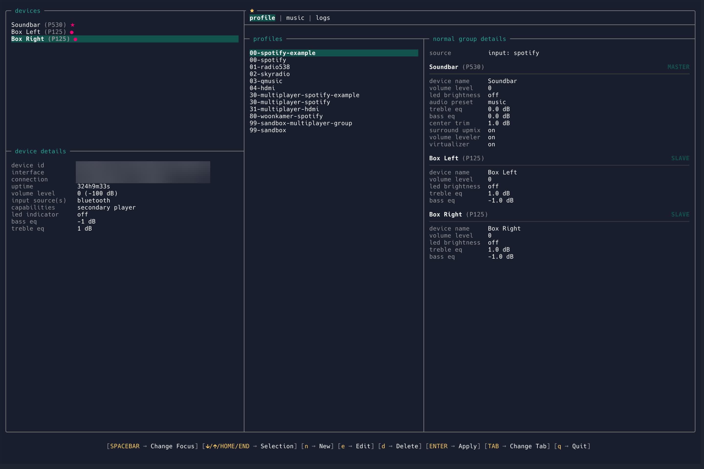
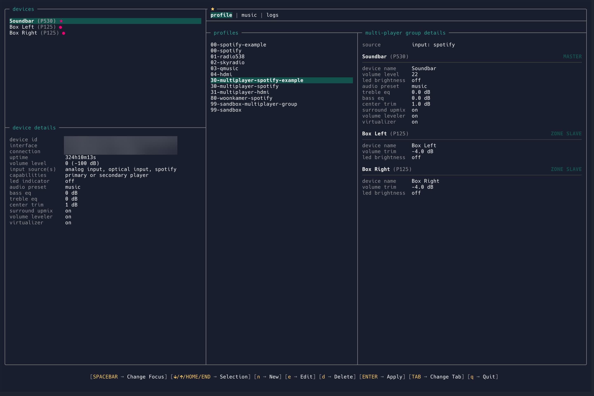
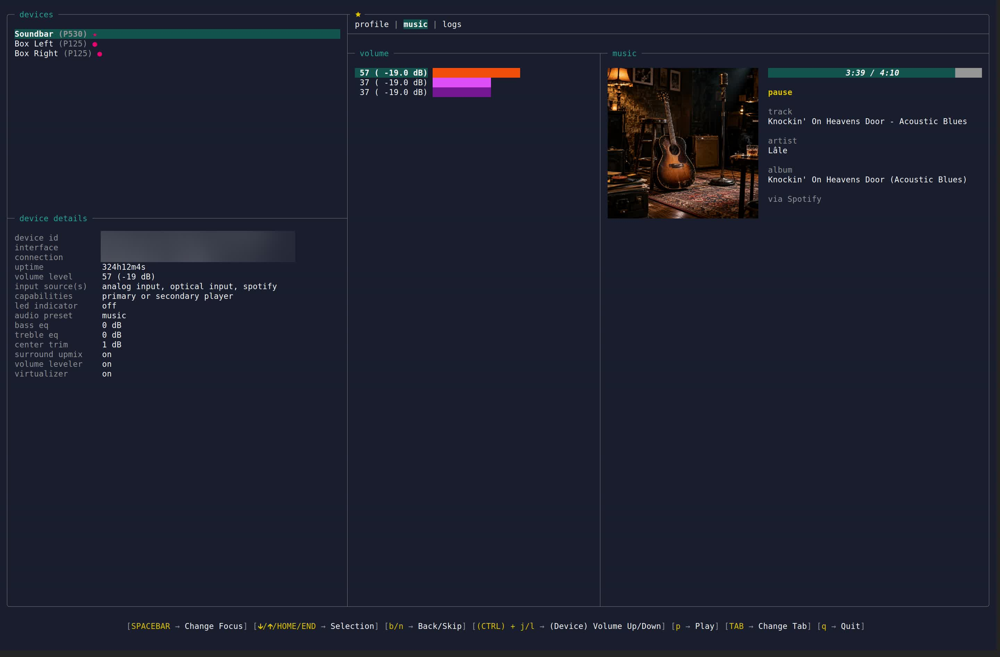

```txt
╔══╗ ╔╗     ╔════╗╔╗ ╔╗╔══╗
║╔╗║ ║║     ║╔╗╔╗║║║ ║║╚╣╠╝
║╚╝╚╗║║ ╔╗╔╗╚╝║║╚╝║║ ║║ ║║ 
║╔═╗║║║ ║║║║  ║║  ║║ ║║ ║║ 
║╚═╝║║╚╗║╚╝║ ╔╝╚╗ ║╚═╝║╔╣╠╗
╚═══╝╚═╝╚══╝ ╚══╝ ╚═══╝╚══╝
```

A terminal user interface compatible with BluOS, letting you control multi-player setups with profiles.

## Screenshots






